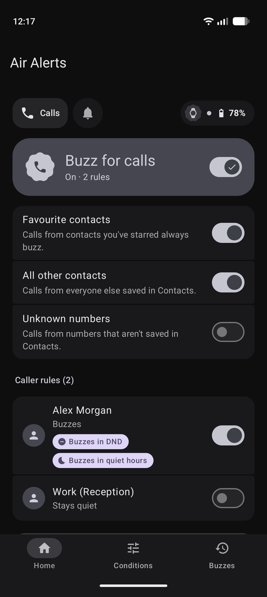
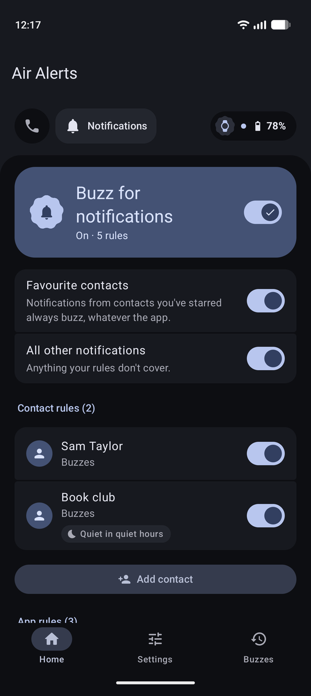
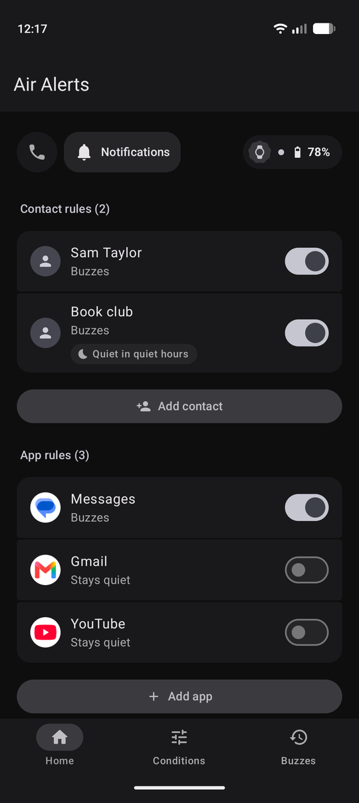
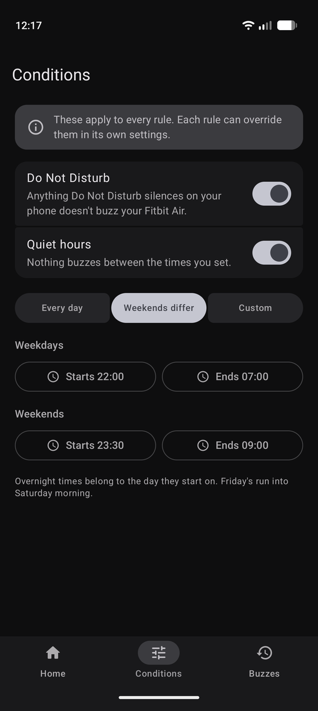
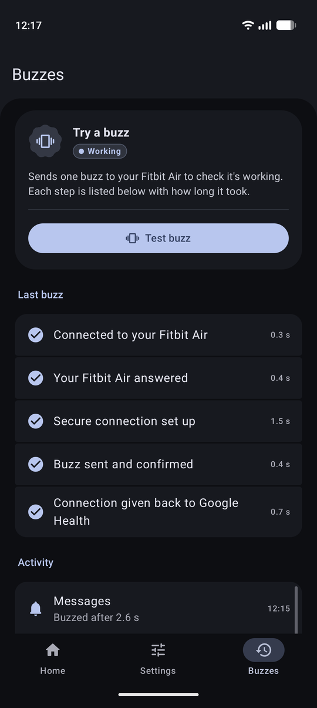
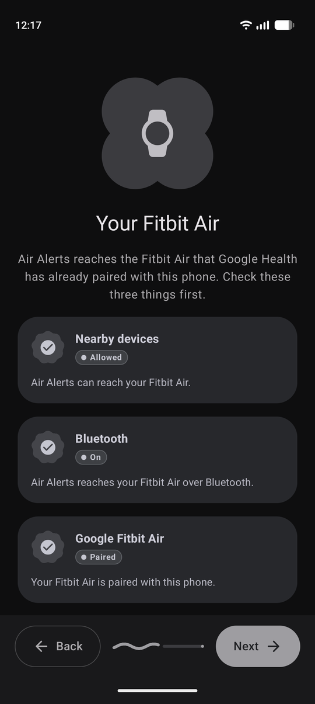

# Air Alerts

Call and notification buzzes for the Google Fitbit Air.

Your Fitbit Air keeps buzzing while a call rings and buzzes once for each notification, with rules for which callers, contacts and apps buzz and which stay quiet. Everything is free for 30 days, then a one-off purchase unlocks it for good. There are no ads, no subscription, no accounts and no analytics. The app has no internet permission at all, so nothing leaves your phone except Bluetooth messages to your Fitbit Air.

Air Alerts is unofficial. It isn't made by, or affiliated with, Google or Fitbit, and a Fitbit Air or Google Health update could stop it working. Version 0.9.0 is a beta.

<p align="center">
  
  
  
  
  
  
</p>

## Features

**Calls**
- Your Fitbit Air keeps buzzing, about once a second, while a call rings, and stops as soon as the call is answered, declined or missed. It stops after a minute at most.
- Works for phone calls and for calls in apps such as WhatsApp. Calls you make don't buzz.
- Favourite contacts: calls from contacts you've starred always buzz.
- Separate switches for all other contacts and for unknown numbers, meaning numbers that aren't saved in Contacts.
- Caller rules: pick a contact and set their calls to buzz or stay quiet.
- A caller rule is checked first, then favourites, then all other contacts or unknown numbers.

**Notifications**
- One buzz for each notification that makes a sound or vibrates your phone. Silent notifications and ongoing ones such as music and downloads don't buzz.
- Messages that arrive while a buzz is going out share the next one, so a burst of messages doesn't buzz over and over.
- Favourite contacts: notifications from contacts you've starred always buzz, whatever the app.
- Contact rules, matched by the sender's name in any app, so a WhatsApp message from one person can buzz or stay quiet.
- App rules: set any app to buzz or stay quiet.
- All other notifications: one switch for anything your rules don't cover.
- A contact rule wins, then favourites, then an app rule, then All other notifications.

**Conditions**
- The Conditions tab sets two defaults that apply to every rule: Do Not Disturb and quiet hours.
- Do Not Disturb, on to start with: anything Do Not Disturb silences on your phone doesn't buzz your Fitbit Air. People and apps that Do Not Disturb lets through still buzz. Turn it off and Do Not Disturb doesn't affect buzzes.
- Quiet hours, off to start with: nothing buzzes between the times you set. The hours can run overnight.
- Quiet hours can be the same every day, differ at weekends (weekend days follow your region) or be set for each day, and any day can have none.
- Tap any rule or switch on the Calls or Notifications page, including favourites, all other contacts, unknown numbers and all other notifications, to give it its own conditions.
- For Do Not Disturb, a rule can follow the Conditions tab, always buzz even in Do Not Disturb, or stay quiet whenever Do Not Disturb is on, even for things it lets through.
- For quiet hours, a rule can follow the Conditions tab, always buzz even in quiet hours, or stay quiet during its own hours.
- Rules with their own conditions show small chips under them saying so. The switch on each row sets whether it buzzes or stays quiet.

**Home**
- Calls and Notifications pages, each with its own on/off switch. Both start off, and rules are kept while a page is off.
- A status chip beside the Calls and Notifications switcher shows your Fitbit Air's state and battery level. Tap it for a status card with when it last buzzed, the battery level and a Test buzz button.
- The battery level is read whenever you open Home, at most once a minute, by borrowing the band's channel for a few seconds.
- If something is stopping buzzes, such as Bluetooth being off, a permission being revoked or no Fitbit Air being paired, a card on Home says what and how to fix it.

**Buzzes**
- A Test buzz button that sends one buzz to check everything is working.
- Each step of the last buzz, whether it was a test, a call or a notification, with how long it took: connected to your Fitbit Air, your Fitbit Air answered, secure connection set up, buzz sent and confirmed, connection given back to Google Health.
- A list of recent buzzes and misses, with the reason for each miss.

**Setup**
- First-run setup walks through Nearby devices, Bluetooth, pairing, notification access and the optional Contacts permission, then finishes with a test buzz.

**What a buzz is like**
- A quick double pulse at your usual buzz strength.
- It usually lands two to seven seconds after the notification, because each buzz has to borrow the band's one secure channel from Google Health first (see How it works).

## Requirements

- An Android phone running Android 12 (API 31) or later, with Bluetooth Low Energy. Buzzes have been tested on a Pixel 11 Pro; other phones and older Android versions haven't been tried with a Fitbit Air yet.
- If buzzes stop, check the phone's battery settings let Air Alerts run in the background. Some phone makers' battery savers stop apps like this one.
- A Google Fitbit Air already paired with the phone through Google Health. Google Health stays installed, keeps its pairing and keeps syncing as normal.
- Bluetooth on, and your Fitbit Air within reach of the phone.

## Permissions

| Permission | Why |
|---|---|
| Nearby devices | Connect over Bluetooth to the Fitbit Air that's already paired with the phone. Air Alerts never scans for devices and doesn't use location |
| Notification access | See calls and notifications as they arrive, and know when a call stops ringing |
| Contacts (optional) | Tell starred favourites and saved contacts from unknown numbers. Only names are looked up, on the phone |

There is no internet permission, so the app can't send anything anywhere; the only thing that leaves the phone is Bluetooth messages to your Fitbit Air. No phone-state or call-log permission is used: calls are recognised from the calling app's own notification. Notification content isn't stored. Only the app's name and the time are kept for the Buzzes list, and the sender or caller's name is compared with your rules on the phone. Settings, rules, the last 30 buzzes, the steps of the last buzz, the last battery reading, the date the free trial started and whether the app is unlocked are stored on the phone only, and uninstalling removes them all. See [PRIVACY_POLICY.md](PRIVACY_POLICY.md) for the full policy.

## How it works

The Fitbit Air has no buzz command for other apps, and it has one secure Bluetooth channel, which Google Health uses. So for each buzz Air Alerts:

1. Borrows that channel for a few seconds. It only ever connects to the Fitbit Air that's already paired, and never scans.
2. Changes the band's buzz-strength setting, then changes it back. The band buzzes when that setting changes, which is felt as a quick double pulse at your usual strength. The setting ends where it started, so nothing is changed permanently.
3. Hands the channel back to Google Health, which carries on syncing as normal.

That borrowing is why a buzz usually lands two to seven seconds after the notification, and why a buzz is occasionally missed when Google Health is using the channel at the same moment. The Buzzes tab lists every miss with its reason.

Under the hood, `band/` is a pure-Kotlin port of Fitbit's Golden Gate stack: GATT, then Gattlink, IPv4/UDP, DTLS 1.2 with a pre-shared key (the phone is the server) and finally CoAP, where the band's `/settings` resource holds the buzz strength. Whatever happens during a buzz (success, failure, timeout, cancellation), the channel is handed back and the app's Bluetooth connection is closed.

A notification listener sees calls and notifications as they arrive and checks each against your rules. A ringing call repeats the buzz about once a second until its notification changes or goes, for a minute at most.

## Building

Standard Android Gradle project with a single `:app` module. Open in Android Studio or run:

```bash
./gradlew assembleDebug
```

```bash
./gradlew testDebugUnitTest
```

Anything that touches the band needs a physical Android phone and a Fitbit Air.

## Join the beta

Air Alerts is in a closed beta on Google Play, so you need to join the test before you can install it.

1. Join the [Air Alerts testers group](https://groups.google.com/g/air-alerts-testers) with the Google account you use for the Play Store. Anyone can join. The group is only there to give test access, and you won't get emails from other members.
2. [Opt in to the test](https://play.google.com/apps/testing/com.mwilky.airalerts), on the web or on your phone. It can take a few minutes after joining the group before this page works.
3. Install Air Alerts from [Google Play](https://play.google.com/store/apps/details?id=com.mwilky.airalerts).

Please stay opted in for at least 14 days if you can. Google needs a group of testers for 14 days before the app can go public. Feedback and bugs are welcome on [GitHub issues](https://github.com/mwilky/air-alerts/issues).

## Pricing

Air Alerts is in a closed beta on [Google Play](https://play.google.com/store/apps/details?id=com.mwilky.airalerts) (see Join the beta). Everything works free for 30 days, counted from the first time you open the app. After that, every buzz stops (calls, notifications and Test buzz) until a one-off purchase through Google Play unlocks it for good. There is no subscription and there are no ads. Your rules, conditions and settings are kept while it's locked, and buzzes start again as soon as you unlock.

## Credits

- The Bluetooth stack is a Kotlin port of Fitbit's [Golden Gate](https://github.com/Fitbit/golden-gate), used under the Apache License 2.0.
- Fitbit Air protocol details come from the open-source [fitbit-air](https://github.com/ThoreKoritzius/fitbit-air) project by ThoreKoritzius, under the MIT licence.
- DTLS is provided by [Bouncy Castle](https://www.bouncycastle.org/).

## Disclaimer

Air Alerts is an unofficial app. It isn't made by, endorsed by or affiliated with Google or Fitbit; Fitbit Air, Google Health and Pixel are trademarks of Google LLC. It is provided as is, without warranty of any kind. You use it at your own risk: the developer isn't responsible for any damage to your phone, your Fitbit Air or anything else.

## Licence

GPL-3.0. See [LICENSE](LICENSE).
